# Prompt, Context, Harness and Loop Engineering

## Foundations

- **Agent** An LLM-based system that can take actions, observe what happened, and decide what to do next, rather than responding only once. Agents are only as useful as the model and the harness around them.

- **LLM (Large Language Model)** The model at the center of an agent that reads context, decides what to do, and generates text or tool calls. Choosing which LLM to use is a design decision that affects cost, speed, and quality.

- **Tool** A function the agent can call to act on the outside world, such as fetching a document, reading or writing a file, or opening a pull request. Good tool descriptions matter because the model relies on them to decide when and how to use each tool.

- **Observation** The result a tool returns to the model after a call. The model uses observations to decide its next step.

- **Context Everything** the model sees on a given call, including the prompt, tool descriptions and results, human and AI messages, retrieved documents, and memory.

- **System Prompt** The instructions provided when an agent is created and sent on every call. Distinct from an instruction file such as AGENTS.md, which can be modified over time, and from skills, which are loaded only when needed.

- **Non-determinism** The property that an agent can behave differently across runs, even with the same code and the same input. It is why an agent's behavior must be understood from its traces rather than from its code alone.

## Engineering Disciplines

- **Prompt Engineering**: Optimizing the instructions given to a language model to achieve the desired output. This involves crafting prompts that are clear, specific, and structured in a way that guides the model's responses effectively.

- **Context Engineering**: Making right information like tool description and results, retrieved documents, memory available to the model to help it generate more accurate and relevant responses. This includes providing background information, relevant data, and any necessary context that can influence the model's understanding of the task.

- **Harness Engineering**: Shapes the system around the model: tool, middleware, permissions, workflows that determines how an agent should operate. This involves designing the architecture and components that interact with the model, ensuring that it can access the necessary resources and perform its tasks efficiently.

- **Loop Engineering**: Shapes how the system repeatedly acts, evaluates, and improves itself. This includes implementing feedback loops, monitoring performance, and making iterative adjustments to enhance the model's capabilities and outputs over time.

- **Agent Harness**: The combination of tools, instructions, skills, memory, and other supporting systems surrounding the model. Improving the harness improves every future run of the agent.

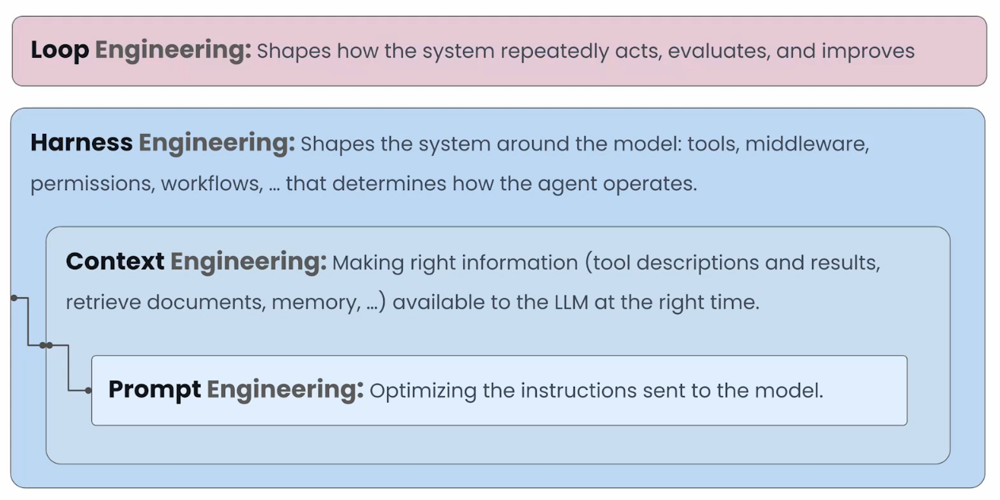

## Types of Loops

1. **Agent Loop** - Automate Fundamental Workflows

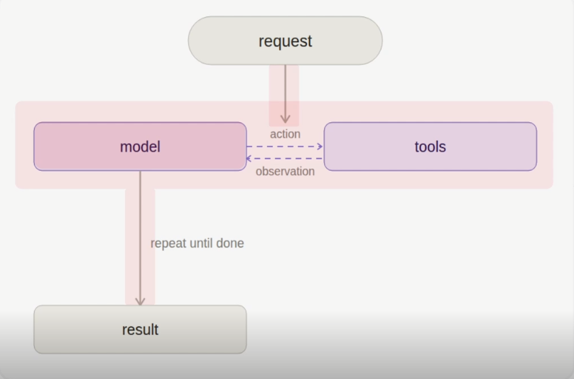

2. **Verification Loop** - Improve end-to-end reliability and correctness of the system. It check the output againt a given rubric

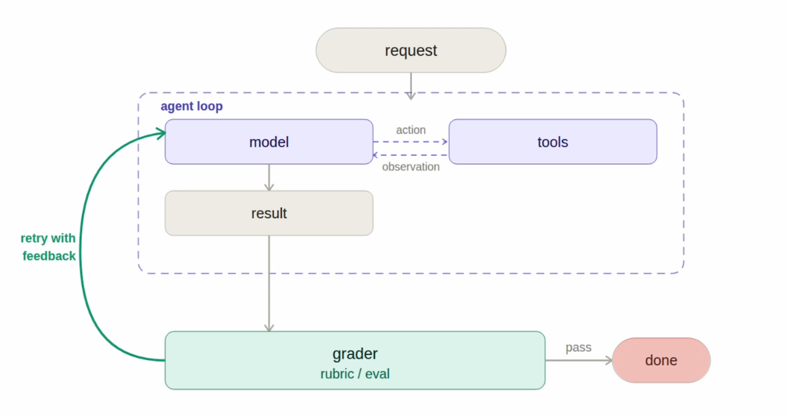

**NOTE** - These are very powerful when we want to use a cheaper model for complex or challenging tasks

3. **Event-Driven Loop** - Automate work in real world systems.

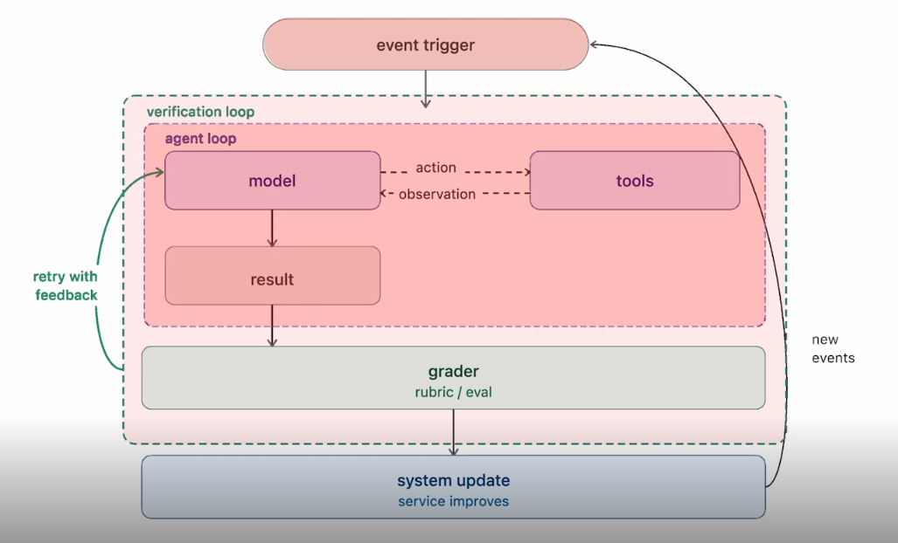

4. **Hill Climbing Loop** - Optimize and improve the agent itself.

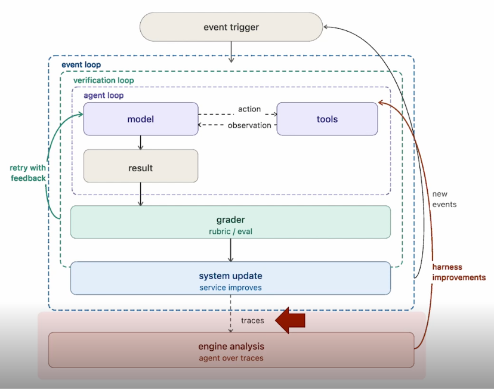

To verify the changes made to the harness we need to run evals

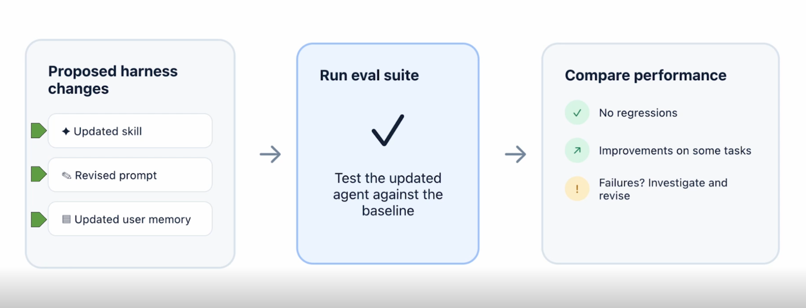

## The Core Agent Loop

- Agent Loop (Core Loop) The basic execution cycle in which the model receives context, calls tools, observes the results, and continues until the task is complete. Every other loop is built around it.

- ReAct Agent An agent pattern (short for Reasoning and Acting) in which the model interleaves reasoning with tool calls and observations in a repeating loop until it can answer. It comes from a 2022 research paper and is the foundation of most agent frameworks.

- Maximum Model Turns A limit on how many times the model can be called in a single run. It is not the normal stopping mechanism, since the loop usually ends when the model finishes the task. It acts as a safety net when the model keeps retrying past the point where retrying makes sense.

- Model Selection Matching model capability to task complexity within the core loop. A cheaper, faster model suits simple tasks and a slower, more capable model suits complex ones, which optimizes cost.

## Agent Harness Features

- Middleware Code added at critical points in the agent loop, before and after the agent, the model, or tools. It is how extra features are layered onto a base agent.

- Deep Agent An agent built on a base ReAct loop with added middleware for longer-running tasks. Its four pillars are the execution environment, delegation, context management, and steering.

- Execution Environment The pillar that lets an agent act in the real world. It includes tools, a file system (the backbone of a deep agent), and optionally a code interpreter or sandbox for running code.

- Sandbox An isolated environment where an agent can safely generate and execute code.

- Delegation The pillar in which an agent plans for a complex task and dispatches smaller units of work to subagents.

- Context Management The pillar covering memory and skills, along with summarization and context offloading, which keep long-running interactions workable.

- Prompt Caching Reusing repeated context across model calls to reduce cost and latency. Deep agents enable it by default regardless of model provider.

- Steering The pillar covering human-in-the-loop controls and grading rubrics that guide the agent toward the intended outcome.

## Instructions and Memory

- AGENTS.md An instruction file that is loaded into the agent's context at the start of every run and can be modified over time. Distinct from skills, because all of its content is always loaded.

- Skill A file of specialized instructions for one kind of task, loaded on demand using progressive disclosure. Its frontmatter describes what it contains.

- Frontmatter The short header at the top of a skill file that describes its contents. The agent reads it to decide whether to load the full file.

- Progressive Disclosure Loading only a short description of each skill at the start of a run and the full content only when the agent needs it. This keeps the context from filling with unneeded detail.

- Memory Information persisted across runs, such as user preferences, so that guidance given once is available in future runs.

- Memory Consolidation A background task that organizes what an agent has learned into persistent memory so the harness improves over time.

## Verification Loop

- Verification Loop (Goal Loop) A loop around the core agent loop in which a grader checks the agent's output against explicit criteria and sends feedback back for another attempt if something is missing. It improves quality and reliability, and it is especially useful when using a cheaper model on challenging tasks.

- Grader An agent that decides whether the task is actually complete by scoring the result against a rubric. Using a different model for the grader than for the agent is a common production choice.

- Rubric The explicit definition of what a good result looks like, made of criteria that are each judged pass or fail. The output is accepted only when every criterion passes.

- Rubric Criterion A single pass-or-fail check within a rubric, such as completeness, clarity, or depth. Good criteria are specific enough for the grader to name the exact gap when one fails.

- Grader Feedback The specific explanation of what is missing, sent back to the agent after a failed evaluation. Vague feedback leads to guessing, while specific feedback leads to targeted revisions.

- Maximum Rubric Iterations The number of times the grader may send work back to the agent. Setting it to zero removes the verification loop and leaves the basic agent loop. Distinct from maximum model turns, which limits model calls within a single agent run.

## Event-Driven Loop

- Event-Driven Loop A loop that connects the agent to an application and runs it in response to real-world events, answering the question of when the agent should execute. It makes agents easy to use in the places where work already happens, and it improves the system it is embedded in.

- Trigger The thing that starts an agent run. Triggers can be scheduled, such as a daily summary, or ad hoc and event-driven, such as a new email, message, or ticket.

- Nested (Composable) Loops The idea that loops can sit inside one another, such as an event trigger wrapping a verification loop wrapping a core agent loop. Loops are composable, so an event-driven loop can wrap only a core agent loop without a verification loop.

- Integration A connection between an agent and an external tool so that events in the tool can start the agent and the agent can send results back. An agent can be integrated with any tool used in a workflow, not only a specific one.

- Chat Bot An app installed in a messaging workspace that listens for direct messages or mentions and replies in the same conversation. Mentioning it in a team channel makes the agent's output part of the team discussion, not a private exchange.

- Automation Rule A rule inside a work tool, such as an issue tracker or a wiki, that performs an action when a condition occurs. In an event-driven loop, the action is typically calling the agent through a webhook.

- Webhook A web address that a tool calls automatically when an event happens, sending the event details to the receiver. It is how a tool without a built-in agent can start an agent run.

- Tunneling Service A service that exposes an agent running on a local machine at a public web address. It is needed when external tools that send webhooks must reach an agent that is not hosted on the internet.

- API Credentials Keys or tokens that authorize an agent or bot to use a service, such as a model provider, a chat tool, or a project tracker. They are stored in an environment file or secrets manager, not written into the code.

- Dual-Format Response Returning a result both in a format that reads well inside the destination tool and as raw Markdown that can be copied into other parts of the workflow.

- Agent Specification A written description of the desired behavior, inputs, and integrations that a coding agent can use to build the same event-driven loop on top of an existing agent.

## Hill-Climbing Loop

- Hill-Climbing Loop (Learning or Self-Improvement Loop) A loop that looks across traces from many completed runs, finds recurring problems, and uses them to improve the agent's harness for future runs. Distinct from the verification loop, which improves only the current run and leaves the agent starting from the same place next time.

- Trace The record of every step an agent took for a given task. Because agents are non-deterministic, the story of what happened is in the trace and not in the code.

- Failure Mode A recurring way an agent goes wrong, such as a tool called with improper arguments, a critical tool call missed because the context was lacking, or a system prompt containing misleading information.

- Analysis Agent (Helper Agent) An agent that reads traces after the main run is done, detects failure modes, and proposes updates to the harness such as prompts, tools, skills, or memory.

- Harness Change Proposal A human-readable summary of what an analysis agent wants to change, including the evidence, the existing content, and the proposed update. It is reviewed by a person before being applied.

- Eval (Evaluation Suite) A set of tasks used to measure an agent's quality. It gives confidence that a change to the harness helps and does not hurt.

- Regression A case where a change makes the agent worse on tasks it previously handled well. Running an eval suite before merging a change is how regressions are caught.

## Human Oversight at Each Loop Level

1. In Agent loop we can add human in the loop for important or sensitive tool calls in that core loop

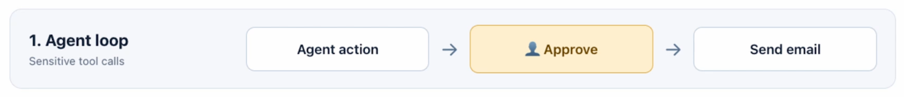

2. Added human to a grader or verifier cycle basically plugging in some form of human approval in the grader stage.

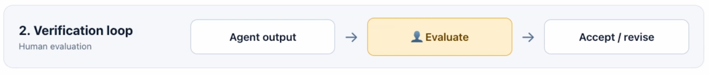

3. Adding human verification to the event action gets competed

4. Adding human verification to harness and code changes.

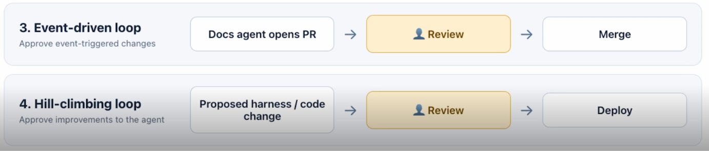

- Human-in-the-Loop Adding a person to approve or review at chosen points while an agent is automated. Humans remain important even in highly automated systems.

- Human Approval Points The four places a person can be added. These are approval on sensitive tool calls in the core loop, approval within the grader or verifier stage, approval of agent artifacts or results, and approval of changes to the core agent's harness and code.

## Putting it all together

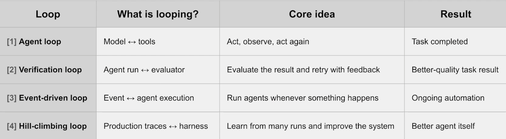

# Creating Looping AGENTS using Langchain

Langchain has a base **ReAct** agent in the langchain birary. It is simple a model calling tools in a Loop.

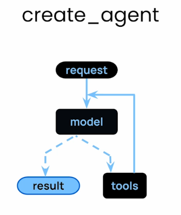

That agent can be enhanced by adding code at critical points in the loop. This is called **Middleware** You can add code befor or after the agnet, model and tools

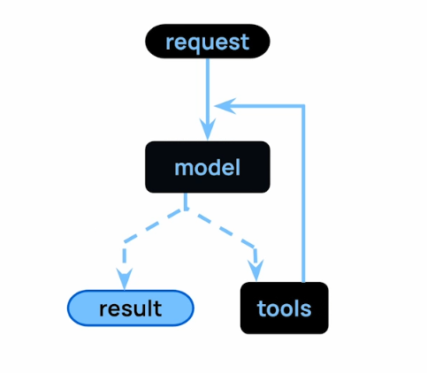

Langchain offers a **create_deep_agent** primitive that adds middleware to enable the list of features you see here.

There are four core pillars of a deep agent as follow:

1. Execution Environment: WHich contains

- Tools
- FileSystem
- Code Interpreter
- Sandbox

2. Delegation

- Planning
- Subagents

3. Context Management

- Memory: Agent.md
- Skills
- Summarization
- Context Offloading
- Prompt caching

4. Steering

- Human-in-the-Loop
- Gradding Rubrics
